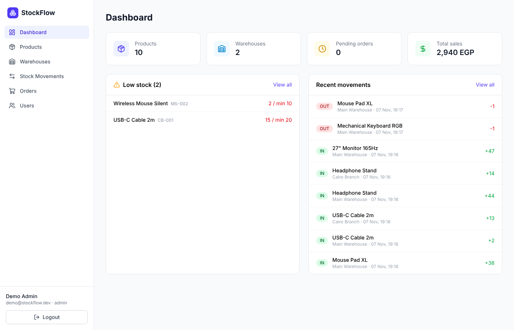
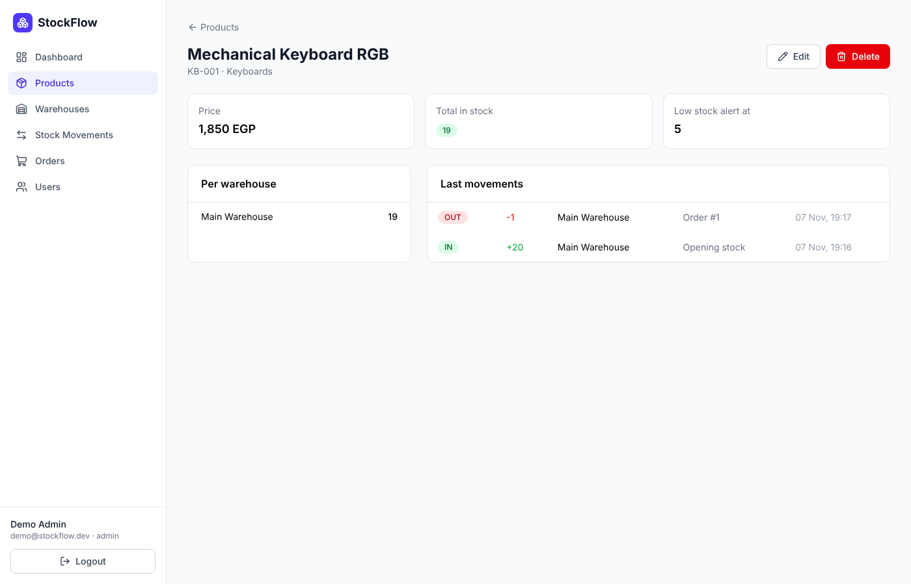
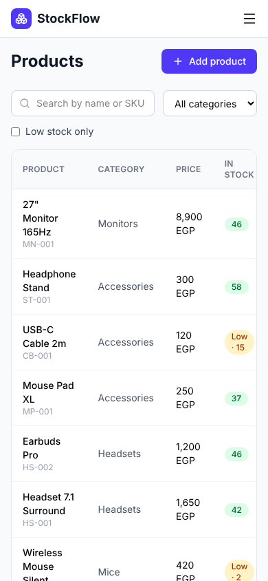

# StockFlow

Inventory and order management for small shops that sell from more than one warehouse.
You add your products, track how much you have in every warehouse, and when an order gets
confirmed the items are taken out of stock automatically. Products that go under their
minimum show up on the dashboard so you know what to re-order.

I built it because a lot of the shops I work with (gaming accessories, phone shops) still do
this in Excel or WhatsApp and always find out something is out of stock after a customer
already paid.

**Live demo:** _coming soon_ · **API docs (Swagger):** _coming soon_

Demo login: `demo@stockflow.dev` / `demo1234` (or click "Use demo account" on the login page)



## Features

- **Auth** – register / login with JWT, passwords hashed with bcrypt, two roles (`ADMIN`, `STAFF`)
- **Products & categories** – CRUD, search by name or SKU, filter by category or low stock, pagination
- **Warehouses** – stock is tracked per product per warehouse
- **Stock movements** – every change is saved as a movement (`IN`, `OUT`, `ADJUST`) with who did it
  - `ADJUST` is for stock counts: you enter the real number and it saves the difference
  - transfer between warehouses in one step
- **Orders** – `PENDING → CONFIRMED → SHIPPED → DELIVERED`, or `CANCELLED`
  - confirming takes the items out of the warehouse, cancelling a confirmed order puts them back
  - prices are taken from the database, not from the request
- **Dashboard** – totals, sales, low stock list and latest movements
- Responsive, works fine on mobile

| | |
|---|---|
|  |  |

## Tech stack

| Part     | Tech |
|----------|------|
| Frontend | React 19, TypeScript, Vite, Tailwind CSS, TanStack Query, React Router |
| Backend  | Node.js, NestJS, REST API, class-validator, Swagger |
| Database | PostgreSQL + Prisma ORM (migrations + seed) |
| Auth     | JWT (Bearer token), bcrypt, role guard |
| Testing  | Jest + Supertest (e2e on a real Postgres), Vitest |
| DevOps   | Docker / docker-compose, GitHub Actions CI |

## Project structure

```
stockflow/
├── apps/
│   ├── api/                 # NestJS REST API
│   │   ├── prisma/          # schema, migrations, seed
│   │   ├── src/
│   │   │   ├── auth/        # register, login, jwt guard, roles guard
│   │   │   ├── products/
│   │   │   ├── categories/
│   │   │   ├── warehouses/
│   │   │   ├── stock/       # movements + transfers (changeStock is used by orders too)
│   │   │   ├── orders/      # order flow + status rules
│   │   │   ├── dashboard/
│   │   │   ├── users/
│   │   │   └── common/      # decorators, pagination, prisma error filter
│   │   └── test/            # e2e tests
│   └── web/                 # React app
│       └── src/
│           ├── api/         # axios client + types
│           ├── components/
│           ├── hooks/
│           └── pages/
├── docker-compose.yml
└── .github/workflows/ci.yml
```

## Database

```
User ──< StockMovement >── Product >── Category
                │              │
Warehouse ──────┘     Stock (productId + warehouseId → quantity)
    │
    └──< Order ──< OrderItem >── Product
```

- `Stock` has a composite key `(productId, warehouseId)` so every product has one row per warehouse.
- Taking stock out is done with a conditional update (`WHERE quantity >= n`) inside a transaction,
  so two orders confirmed at the same time can't make the quantity go below zero.

## API

All routes are under `/api` and need `Authorization: Bearer <token>` except register, login and health.
Full docs with request bodies are in Swagger at `/api/docs`.

| Method | Route | Notes |
|--------|-------|-------|
| POST | `/auth/register` | new users are `STAFF` |
| POST | `/auth/login` | returns `{ token, user }` |
| GET | `/auth/me` | current user |
| GET | `/products` | `?search=&categoryId=&lowStock=true&page=&limit=` |
| GET | `/products/:id` | with stock per warehouse + last movements |
| POST / PATCH | `/products`, `/products/:id` | |
| DELETE | `/products/:id` | admin only |
| GET / POST / PATCH / DELETE | `/categories` | write = admin only |
| GET / POST / PATCH / DELETE | `/warehouses` | write = admin only |
| GET | `/stock/movements` | `?productId=&warehouseId=&type=&page=` |
| POST | `/stock/movements` | `{ type, productId, warehouseId, quantity, note }` |
| POST | `/stock/transfer` | `{ productId, fromWarehouseId, toWarehouseId, quantity }` |
| GET | `/orders` | `?status=&search=&page=` |
| GET | `/orders/:id` | |
| POST | `/orders` | `{ customerName, warehouseId, items: [{ productId, quantity }] }` |
| PATCH | `/orders/:id/status` | `{ status }` – returns 400 if the change isn't allowed |
| GET | `/dashboard` | stats for the home page |
| GET / PATCH | `/users`, `/users/:id/role` | admin only |

Errors come back as `{ statusCode, message }` (400 validation, 401, 403 role, 404, 409 duplicate).

## Running it locally

You need Node 20+ and PostgreSQL (or Docker).

```bash
git clone https://github.com/paoloothedev/stockflow.git
cd stockflow
npm install

# start postgres (skip if you have it installed)
docker compose up -d db

# api
cp apps/api/.env.example apps/api/.env
npm run db:migrate -w apps/api
npm run db:seed -w apps/api
npm run dev:api          # http://localhost:3000/api  (swagger: /api/docs)

# web (another terminal)
npm run dev:web          # http://localhost:5173
```

The Vite dev server proxies `/api` to `localhost:3000`, so no CORS setup is needed locally.

Or run the api + db with Docker: `docker compose up --build`

## Tests

```bash
npm test -w apps/api          # unit tests
npm run test:e2e -w apps/api  # e2e, needs DATABASE_URL pointing to an empty test db
npm test -w apps/web
```

The e2e tests go through the real flow: register → roles → add product → stock in/out →
create order → confirm (stock goes down) → cancel (stock comes back) → can't confirm without enough stock.
CI runs lint, build and all tests on every push.

## Deployment

- **Web** → Vercel (`apps/web`, env `VITE_API_URL=<api url>`)
- **API** → Render (Docker, `apps/api`), runs `prisma migrate deploy` on start
- **Database** → Neon Postgres

API env vars: `DATABASE_URL`, `JWT_SECRET`, `JWT_EXPIRES_IN`, `CORS_ORIGIN`, `PORT`.

## What I'd add next

- Refresh tokens instead of one long-lived token
- Supplier purchase orders (so `IN` movements come from a real PO)
- Email / WhatsApp alert when a product hits low stock
- Export reports to Excel
- Multi-tenant so every shop has its own data
